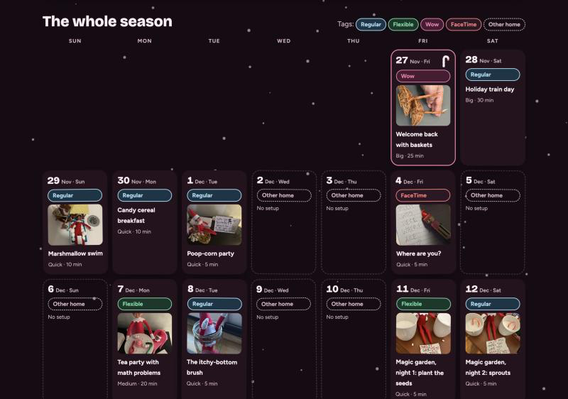

# Elf Night Planner 🎄

A festive, accessible planner for a season of elf-on-the-shelf nights, built to support all families, including co-parenting arrangements.

**Try it:** [elves.patterngrams.com](https://elves.patterngrams.com)

Coming up with elf ideas isn't the hard part. Fitting them to the calendar is. This planner starts from your schedule, tags every night, and gives each one an idea, a materials list, notes, and a sign "written" by the elves.

Pick a **planner type** at the top of the page:

- **Co-parenting:** the kids split time between two homes, **Home A** and **Home B**. Pick whose nights you're planning: each co-parent can use the same planner from their own side. Nights at the other home need no setup, switchover evenings give you more time than a rushed school night, and FaceTime days in the middle of long stretches away let the elves report in.
- **Every night at home:** an elf night every night. Fridays and Saturdays are Flexible nights with more time.

Switching rebuilds the calendar and keeps your ideas, materials, notes and done marks.



## What it does

- **Builds the season from your schedule.** Season dates, the co-parenting pattern (weekly home nights, alternating weekends) and holiday overrides go in `config.json`. The page and `tools/make-season.mjs` share the same rules in `season.js`.
- **Tags every night:** Regular (quick school-night setup) · Flexible (more time tonight) · Wow (big setup). Co-parenting adds FaceTime (kids at the other home call to ask what the elves did) and Other home.
- **One card per night:** the idea, a photo, minutes needed, **materials needed**, **notes**, and a **sign workshop** with a few drafts in the elves' voice. Pick one or write your own.
- **Drag ideas between nights** when plans change. On phones and keyboards, use **Move to a night** instead. Dropping onto a full night swaps the two.
- **Blank nights are obvious.** They show "Still needs planning ✏️", and a counter at the top links to each one.
- **Accessible from the start:** real headings and landmarks, alt text on every photo, a screen-reader announcement for every move, tags that never rely on color alone, and snow that stops when the device asks for reduced motion. Light and dark themes.

## Make it yours

1. **Fork or download** this repo.
2. Edit **`config.json`**:
   - `elves`: your elves' names (the sign workshop signs with them).
   - `mode`: the planner type the page opens with, `"co-parenting"` or `"everyday"`. Visitors can still switch.
   - `year`, `christmas`, `intro` (one line per mode), `otherHomeLabel`.
   - `schedule`:
     - `start`/`end` and shared per-date `overrides` (`tag`, `schedule` note, `ideaId`).
     - `coParenting`: Home A's pattern. Home B gets every other night.
       - `side`: whose nights the page opens with, `"A"` or `"B"`.
       - `homeWeekdays` and `alternatingWeekends` (`firstHomeFriday`, `days`). The example is a common 2-2-5-5 schedule: Home A has Mondays and Tuesdays, Home B has Wednesdays and Thursdays, and weekends alternate.
       - `swaps`: dates that switch homes, like holidays or trades.
       - `facetimeAuto` (a FaceTime day in the middle of each stretch of 3+ nights away) and extra `facetimeDays`.
       - its own `overrides`.
     - `everyday`: `flexibleWeekdays` (default Friday and Saturday) and its own `overrides`.
3. Add your ideas to **`plan.json`** under `ideas` (see the examples), and your own photos to `photos/`.
4. Run `node tools/make-season.mjs` to rebuild the nights for your `mode` and `side` (or `node tools/make-season.mjs everyday`, or `node tools/make-season.mjs co-parenting B`). It keeps any ideas, materials, notes and done marks already in `plan.json`. Add `--fresh` to start over from `config.json`.
5. **Strip photo metadata** before you publish: `python3 tools/strip-metadata.py photos/*.jpg`. Phone photos can carry the exact GPS location where they were taken.

## Run it

It's a static site with no build step and no dependencies.

```bash
python3 -m http.server 8000
```

Then open http://localhost:8000. It has to be served over HTTP (not opened as a file) so it can load `plan.json`.

To host it, upload the folder to any static host: GitHub Pages, Netlify, Cloudflare Pages, or your own domain.

**Where changes are saved:** in the visitor's browser (`localStorage`). Use **Export plan** to download a `plan.json` backup or move it to another device, **Import plan** to load one, and **Reset to plan.json** to start over from the file on the server. Nothing is sent anywhere.

## Planning with Claude

This project was planned and built with [Claude Code](https://claude.com/claude-code). [`CLAUDE.md`](CLAUDE.md) describes the workflow: send screenshots of ideas or photos of supplies you already have, and Claude crops one image per idea, drafts the signs, and puts each idea on a night that fits its effort. Then ask "what's the plan for Dec 7?"

## Photos

Every photo in `photos/` is the author's own, from past seasons in our house. Please use your own photos in your fork.

## License

[AGPL-3.0-or-later](LICENSE). If you run a modified version for other people over a network, share your source under the same license.
